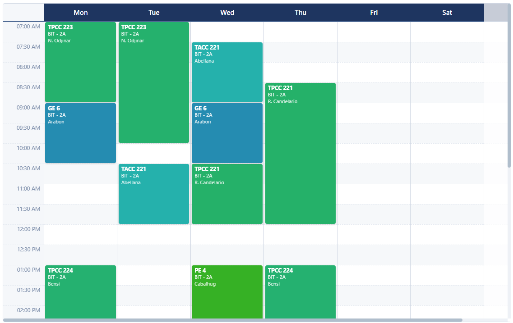

# Welcome to Timetable
**About Timetable**

Managing room schedules for academic use is difficult and painful as more establishment gets involved. Imagine having to assign rooms to hundreds or even thousands of teachers.

Timetable is created to address that problem. It even has a built-in local network collab feature so that multiple people can work on assigning schedules at the same time.

**How does it work?**

Timetable utilizes *tables* to visualize schedules. Within a table is a collection of *blocks*. Each block represents a schedule


*This is a table that contains blocks*

Timetable can also have multiple tables within a single Timetable file (.ttcl) similar to a worksheet in a spreadsheet app. This can be used to organize multiple rooms or establishment with different schedules all through the week.

## Installation

**From an executable file**
1. Download the latest *.exe* file in this repo.
```
https://github.com/izmdev23/Timetable/releases/tag/release
```

2. After download completes, just click it and it should open without installations. If you want an installer, you can built the project from source. See instructions below.

**How to build from source.**
1. Clone the repository.

```bash
git clone https://github.com/izmdev23/Timetable.git
```

2. Go to the project directory.
```bash
cd Timetable
```

3. Install the required modules.
```node
npm install
```

4. Build the project.
```node
npm run tauri build
```

5. After build is successful, the executable file is inside this directory named app.exe:
```
cd src-tauri\target\release
```

## Supported platforms
Currently the project only supports windows. You can extend the project to support to any platforms you want.